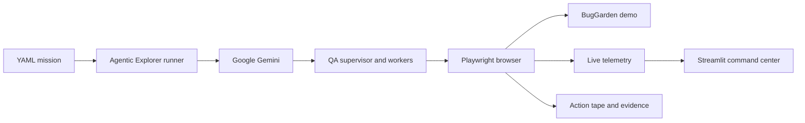

# Agentic Explorer

Agentic Explorer is a Gemini-powered browser QA command center. It sends an
autonomous testing swarm into a real web application, records every browser
action, captures evidence for confirmed issues, and presents the investigation
live in a Streamlit dashboard.

This repository includes **BugGarden**, a local quality-intelligence demo built
for presentations and judging. The demo has a login screen, an application map,
risk filtering, discovery controls, scan feedback, a signal-reporting form, and
a recent-signals feed so the explorer can demonstrate more than authentication.

## What this project demonstrates

- Gemini-only exploratory QA with Playwright and LangGraph.
- A supervisor that routes work to specialized browser-testing agents.
- Deterministic JSON browser commands with resilient selector validation.
- Live browser screenshots, swarm status, action telemetry, and thought events.
- Coverage routes, latency metrics, confirmed bugs, and screenshot evidence.
- Action tapes and reproducible Playwright artifacts for confirmed findings.
- A polished local demo application that is safe to run during a presentation.

## System overview



The runner and dashboard communicate through local runtime files. The dashboard
is read-only: it watches `.agent_state.json` and `.latest_vision.jpg` while the
runner performs the mission.

## Ports

| Service | URL | Purpose |
| --- | --- | --- |
| BugGarden demo | <http://127.0.0.1:5601/> | Application under test |
| Command center | <http://127.0.0.1:8501/> | Live QA dashboard |

Demo credentials: `demo` / `demo123`.

## Quick start

### 1. Install dependencies

Python 3.11 or newer is required.

```powershell
python -m venv .venv
.\.venv\Scripts\Activate.ps1
pip install -e ".[visual]"
playwright install chromium
```

### 2. Create local configuration

The real environment file and runtime configuration are intentionally ignored
by Git. Create them from the safe examples:

```powershell
Copy-Item .env.example .env
Copy-Item config.yaml.example config.yaml
Copy-Item mcp_servers.json.example mcp_servers.json
```

Edit `.env` and provide your own Gemini API key. The important values for the
included demo are:

```env
GOOGLE_API_KEY="your_gemini_api_key"
LLM_PROVIDER="gemini"
GEMINI_MODEL="gemini-3.1-flash-lite"
GEMINI_VISION_MODEL="gemini-3.1-flash-lite"
GEMINI_REPORT_MODEL="gemini-3.1-flash-lite"
GEMINI_SCENARIO_MODEL="gemini-3.1-flash-lite"
APP_URL="http://127.0.0.1:5601"
APP_USERNAME="demo"
APP_PASSWORD="demo123"
```

Never commit `.env` or paste a real API key into a public issue, screenshot, or
pull request.

### 3. Start BugGarden

In the first terminal:

```powershell
python demo_app/server.py
```

Open <http://127.0.0.1:5601/> to inspect the demo manually. After login, the
application presents the full quality workspace.

### 4. Run the Gemini mission

In a second terminal:

```powershell
agent-explorer `
  --missions missions/gemini_smoke.yaml `
  --provider gemini `
  --headed `
  --visual `
  --max-steps 4
```

Open <http://127.0.0.1:8501/> to watch the mission. The dashboard starts with
the runner; if it does not open automatically, visit the URL manually.

The presentation mission is deliberately explicit. It asks the explorer to:

1. log in with the configured demo account;
2. select application-map surfaces;
3. search and change the risk filter;
4. toggle discovery controls and start a focused scan;
5. submit a safe signal for verification;
6. inspect the recent-signals feed;
7. exercise an empty or invalid state and capture confirmed evidence.

## Command center

The dashboard is organized for a live walkthrough:

- **Live target viewport** shows the latest browser frame.
- **Swarm telemetry** shows the active agent and routing graph.
- **Quality snapshot** shows browser actions, errors, latency, and evidence count.
- **Coverage map** shows routes touched by the swarm.
- **Readable event timeline** combines browser events, evidence events, and agent
  messages as they arrive.
- **Evidence vault** previews the executive report and captured screenshots.
- **Investigation tabs** expose missions, thought stream, action tape, bugs, and
  explored paths.

Thoughts and bug evidence are emitted incrementally. Browser actions appear in
the timeline immediately, and a confirmed bug appears when its screenshot
evidence is captured instead of waiting for the entire mission to finish.

## Generated artifacts

Each mission writes a private `report_<thread_id>/` directory containing:

| Artifact | Description |
| --- | --- |
| `traces.log` | Full mission and agent trace |
| `action_tape.jsonl` | Browser commands, results, timing, and URLs |
| `screenshots/` | Evidence frames captured for confirmed issues |
| `reproduction_*.spec.ts` | Generated Playwright reproductions |
| `test_report.md` | Executive mission summary |

Runtime state is also written locally to `.agent_state.json`,
`.latest_vision.jpg`, and `agent_memory.sqlite`. These files are ignored and
must stay out of the public repository.

## Project layout

```text
demo_app/                           BugGarden application under test
missions/gemini_smoke.yaml          Presentation-focused Gemini mission
src/agentic_explorer/main.py        CLI runner and mission lifecycle
src/agentic_explorer/orchestration/ Supervisor and QA worker graphs
src/agentic_explorer/tools/browser/  Playwright command engine
src/agentic_explorer/tools/common/   Screenshot and auxiliary tools
src/agentic_explorer/ui/dashboard.py Streamlit command center
src/agentic_explorer/ui/state_emitter.py Live telemetry bridge
tests/                               Unit and integration tests
JUDGE_RUNBOOK.md                     Short public demo checklist
```

## Run the test suite

```powershell
python -m pytest -q
```

The test suite covers configuration, model wiring, browser command validation,
bug extraction, state emission, dashboard helpers, and swarm diagram generation.

## Troubleshooting

### Dashboard shows an old mission

Start a new mission with a new `thread_id`, or clear only the LangGraph
checkpoints:

```powershell
agent-explorer --clear-checkpoints
```

Then rerun the Gemini mission. The dashboard reads the latest local state file.

### The dashboard says telemetry is stale

Confirm that the explorer process is still running and that you are looking at
the same project folder from which the mission was launched. A completed or
failed run intentionally stops updating the live state.

### Gemini does not respond

Check that `GOOGLE_API_KEY` is valid, `LLM_PROVIDER` is set to `gemini`, and the
configured Gemini model is available to the key. Gemini API quota and service
availability are controlled by Google; the local dashboard will still display
the last browser evidence it received.

## Public repository safety

The repository is designed to be safe for public judging:

- `.env` and credentials are ignored;
- SQLite memory, screenshots, state, and mission reports are ignored;
- the checked-in examples contain placeholders only;
- the included demo account is local to BugGarden;
- no external application credentials are required to inspect the code.

## License

This project is available under the MIT License. See [LICENSE](LICENSE).
